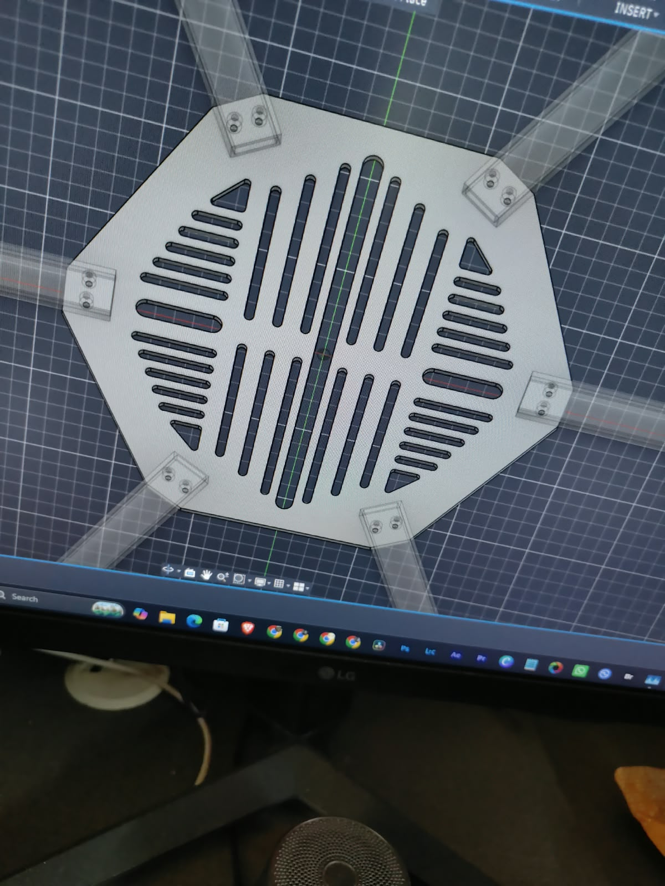
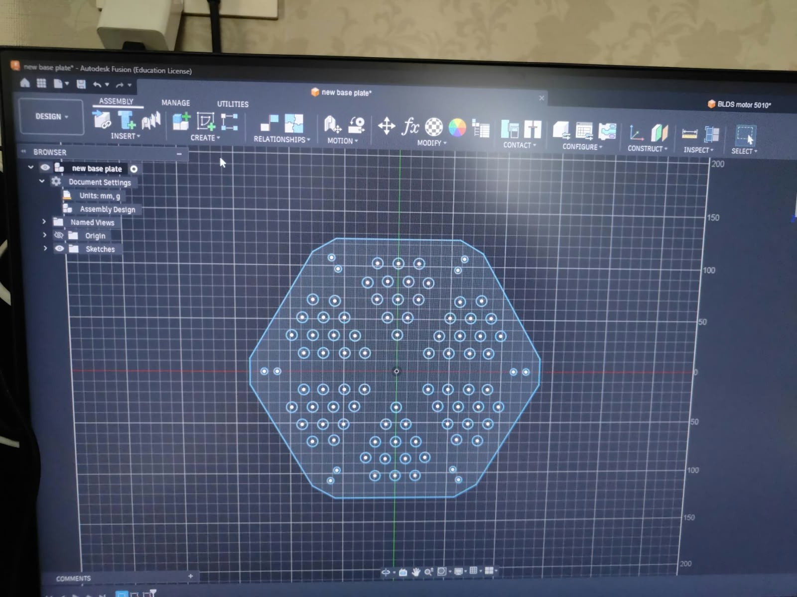
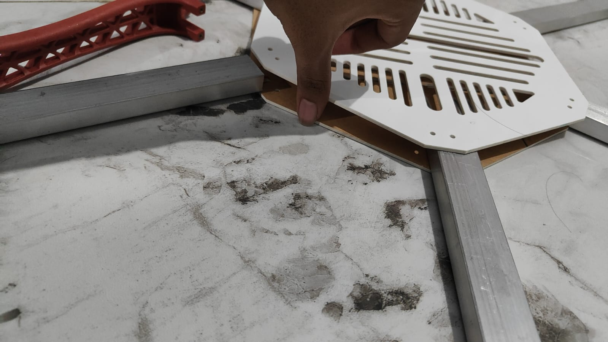
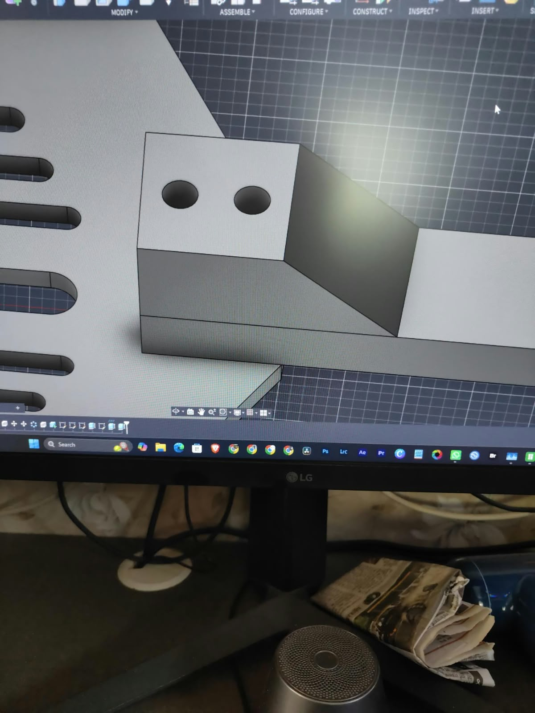
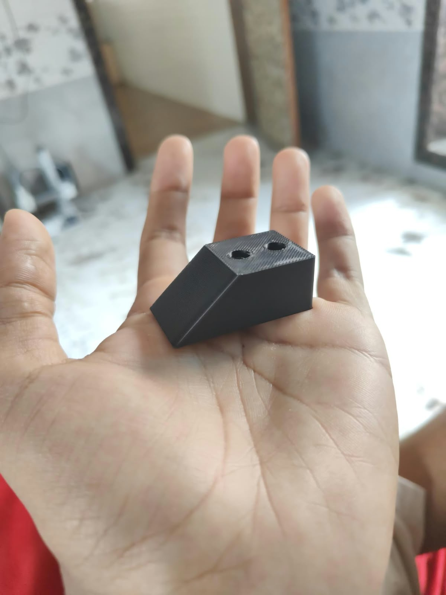

# Heavy-Lift Hexacopter: Mechanical Prototyping & Build Journey

A chronological engineering log documenting the iterative design, mockups, additive manufacturing, and high-current electrical bring-up of the 3.5 kg hexacopter test platform.

---

## 1. Initial CAD Iteration & Design Divergence

| Initial Slotted Airframe Concept | Transition to Hole-Matrix Base Plate |
| :---: | :---: |
|  |  |

* **Revision 1 (Slotted Concept):** Initial Fusion 360 sketches featured parallel linear slot cutouts across the central plate. While lightweight, finite element evaluation and manual deflection testing indicated that long slot spans compromised shear rigidity along the arm mounting axes.
* **Revision 2 (Hole-Matrix Architecture):** Replaced the linear slots with a distributed radial hole matrix. This retained structural web pathways between opposing arms, maximizing torsional stiffness while shedding non-critical plate mass.

---

## 2. Low-Cost Tolerance Validation via Acrylic Mockup

| Acrylic Clearance & Fit Check |
| :---: |
|  |

* **Risk Mitigation Strategy:** Sourcing and machining 4mm 6061-T6 aluminum carry long lead times and high scrap costs.
* **Empirical Verification:** Rapid-prototyped 1:1 acrylic test plates using laser cutting to verify:
  * Center-to-center hole clearances for M6 arm-clamping hardware.
  * Angular radial symmetry and arm-root clearance against the central electronics volume.
  * Fitment and clamping compression on the square aluminum tubing prior to releasing production DXFs to the metal shop.

---

## 3. Custom Arm Clamping Blocks (CAD to Print)

| Parametric Clamp CAD | Printed FDM Clamping Block |
| :---: | :---: |
|  |  |

* **Function:** Clamps the square aluminum arm securely against the 4mm aluminum plate, distributing bolt preload evenly across the top face of the extrusion to prevent tube wall crushing.
* **Manufacturing:** Modeled in Autodesk Fusion 360 with dual clearance holes matching the plate's M6 drill pattern, and 3D printed in high-infill PETG for mechanical toughness and UV/impact resistance.

---

## 4. Powertrain Integration & Wiring Harness Layout

| Powertrain Subsystem Integration |
| :---: |
|  |

* **Component Arrangement:** 5010 750KV BLDC motors paired with dedicated ESCs secured along the inner arm sections.
* **Modular Disconnects:** Terminated each ESC branch with dedicated high-current connectors at the root joint, allowing individual motor testing, thrust stand isolation, and rapid swapping without disassembling the chassis.

---

👉 **[Return to Main Project README](README.md)**
