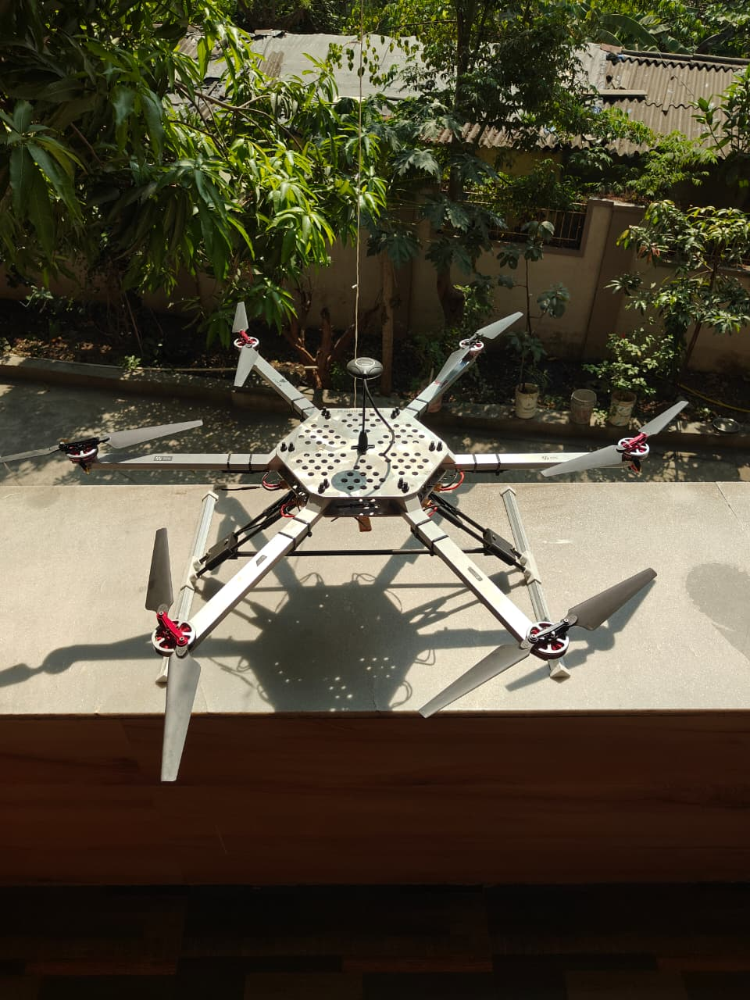
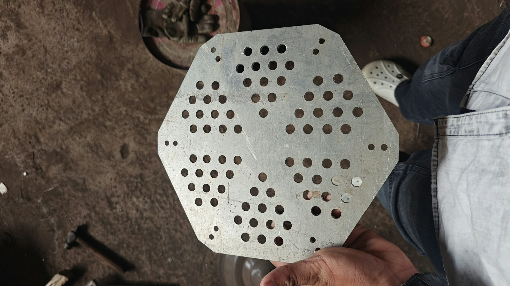
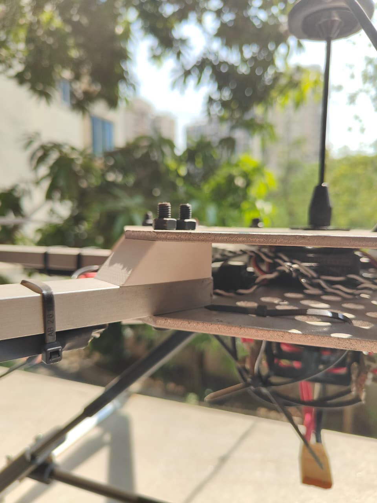
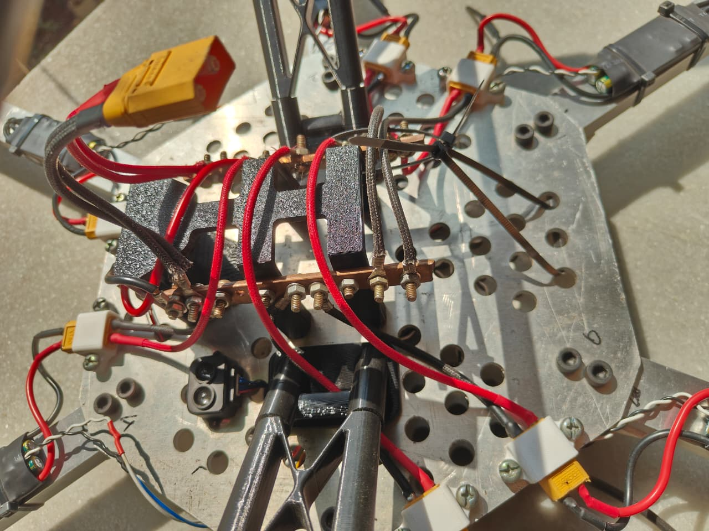
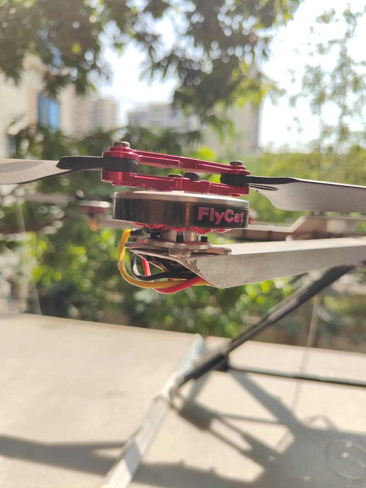
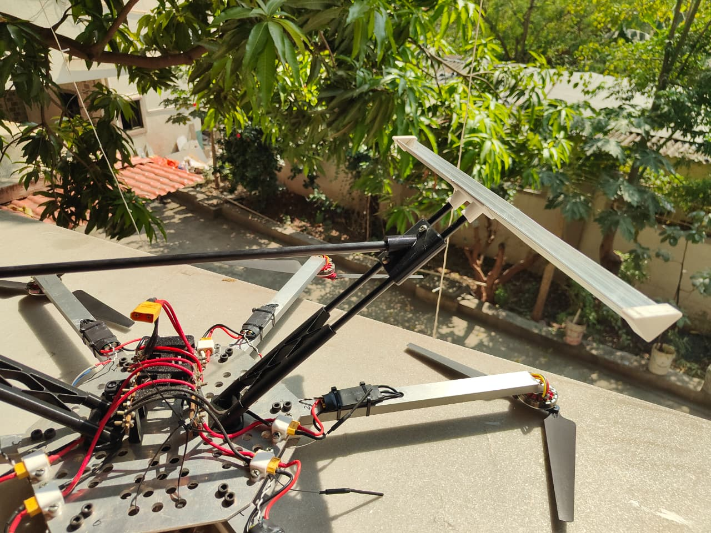

# Heavy-Lift Autonomous Hexacopter: Mechanical & Powertrain Test Mule

A custom-engineered 3.5 kg radial hexacopter platform designed for high-current delivery, structural stiffness, and low harmonic resonance under heavy disc loading (>18.0 kg static thrust). Engineered from raw 6061-T6 aluminum plate and square-section extrusions to evaluate high-thrust payloads and companion compute integration.

[-success)](https://youtu.be/KiL82UazYHw?si=R5Tr-NP9oHPhAmuw)

*Figure 1: Fully integrated radial hexacopter platform showing prop clearance and mast-isolated GPS.*

*Figure 1: Fully integrated radial hexacopter platform showing prop clearance and mast-isolated GPS.*

---

## 1. System Specifications & Key Performance Metrics

| Parameter | Specification | Engineering Justification |
| :--- | :--- | :--- |
| **Chassis Class / Configuration** | Radial Hexacopter (~680mm diagonal) | Redundant 6-axis attitude authority |
| **All-Up Weight (AUW)** | ~3.5 kg (Chassis, Powertrain, Avionics, LiPo) | Optimized structural-to-payload mass ratio |
| **Powertrain Architecture** | 6S LiPo (22.2V nominal) | Low current draw per unit power (P = V × I) |
| **Motors** | 6x 5010 750KV Brushless DC (BLDC) | Low-KV, high-torque direct propeller drive |
| **Propellers** | 1555 Folding Carbon-Nylon Blades | High disk area, efficient static thrust generation |
| **Peak Static Thrust** | **>18.0 kg total** (~3.0 kg / axis peak) | >5:1 Thrust-to-Weight Ratio (TWR) headroom |
| **Hover Throttle Point** | **~25% Throttle** | Preserves ~75% dynamic control headroom under wind |
| **Flight Controller** | Pixhawk (32-bit ARM Cortex-M4) | Runs ArduPilot with EKF3 multi-sensor estimation |
| **Navigation & Compass** | External GPS M8N on Isolated Mast | Eliminates inductive magnetic interference from 6S bus |

---

## 2. Structural Architecture & Mechanical Fabrication

*Figure 2: Raw 4mm 6061-T6 aluminum center plate cut from zero-defect 1:1 DXF profile.*

### Problem Statement: Dynamic Arm Compliance
Off-the-shelf multirotor frames (such as stock nylon-composite F550 arms) suffer from significant torsional flex under high aerodynamic disc loads. When driving 15-inch propellers, arm twisting produces dynamic thrust vector misalignment and injects low-frequency harmonic oscillations into the flight controller gyroscopes, destabilizing the Extended Kalman Filter (EKF).

### Engineering Solution: 4 mm Plate Sandwich & Twin-Bolt Clamping

*Figure 3: Dual 4mm 6061 aluminum plate sandwich clamping square-section arm with axial M6 fasteners.*

* **Radial Center Hub:** Modeled a symmetric chassis in Autodesk Fusion 360 and laser-cut dual 4 mm 6061-T6 aluminum plates (top and bottom).
* **Moment-Resistant Root Joints:** Each hollow square-section aluminum arm is clamped between the 4 mm center plates using **dual M6 Grade 8.8 bolts** spaced linearly along the arm axis. This geometry converts vertical bending moments and horizontal torsional loads at the arm root into pure tension/compression across the sandwich plates, eliminating arm flutter.
* **Design for Manufacturing (DFM):** Exported 1:1, zero-defect DXF profiles directly from sketch geometry, allowing the fabrication shop to nest and cut without file modification or re-scaling. Neutral-stress pockets were integrated to trim rotational inertia without reducing structural clamping perimeter stiffness.

---

## 3. High-Current Power Architecture & Powertrain Integration

| Belly-Mounted Copper Bus Bars | Motor Mount & Internal Arm Harness |
| :---: | :---: |
|  |  |

*Figure 4: Custom solid copper bus bar power distribution (left) and 14 AWG internal arm wire routing (right).*

### Overcoming Standard PDB Limitations
Standard 1 oz / 2 oz multirotor Printed Circuit Boards (PDBs) experience severe thermal rise (ΔT), copper trace degradation, and voltage sag under sustained 6S current delivery and punch-out transients.

* **Custom Solid Copper Bus Bars:** Hand-fabricated dual solid copper power rails secured to the bottom chassis plate with insulated standoffs. Power lines are mechanically fastened with ring terminals and bolted studs, yielding near-zero joint resistance and high continuous amperage capacity.
* **Arm Harness Routing & Shielding:** Escaped raw motor phase lines by running high-strand flexible 14 AWG silicone wire internally through the hollow square aluminum extrusions. The metal tubing provides physical abrasion defense against propeller strikes and serves as a partial RF/EMI shield for nearby sensitive electronics.
* **Modular XT60 Terminations:** Every arm branch features an independent XT60 disconnect at the chassis root, enabling instant bench isolation, per-arm current testing, and rapid field maintenance.
* **Electromagnetic Isolation:** The compass and GPS mast was raised vertically along the central axis to enforce spatial distance (inverse-square distance, 1/r²) from high-current DC flux loops generated by the belly bus bars.

---

## 4. Landing Assembly & Field Readiness

*Figure 5: Elevated landing gear setup providing ground clearance for payload testing.*

* **Attitude Stability:** Initial field validation conducted in `Stabilize` and `AltHold` flight modes confirmed predictable, stable attitude response. The high mechanical stiffness shifted the airframe's natural resonant frequency well outside the motor hover RPM spectrum, eliminating high-amplitude vibrations before they reached the flight controller's internal IMUs.

### 🎥 Maiden Flight Footage
**[▶ Watch Maiden Hover & Flight Test (0:18)](https://youtu.be/KiL82UazYHw?si=3dAUaOYiKBcc10Sj)**  
*Raw, unedited audio and video of first-flight spool-up, ground effect exit, and hover holding.*

---

## 5. Iteration Roadmap (Revision 2)

* [ ] **Chassis Weight Optimization:** Transition from solid 4.0 mm aluminum plates to 2.5 mm / 3.0 mm quasi-isotropic carbon fiber sandwich plates with internal stiffening ribs, targeting a ~30% reduction in chassis mass.
* [ ] **Hardware Downsizing:** Replace M6 structural steel fasteners with high-tensile M4 socket head cap screws recessed into captive PETG/CNC clamping blocks.
* [ ] **Integrated Carrier Board:** Consolidate external bus bars and discrete wiring into a custom 4-layer, 4 oz copper power distribution board featuring onboard Hall-effect current sensing, TVS inductive spike suppression, and a regulated 5V/5A buck converter for companion compute payloads.
